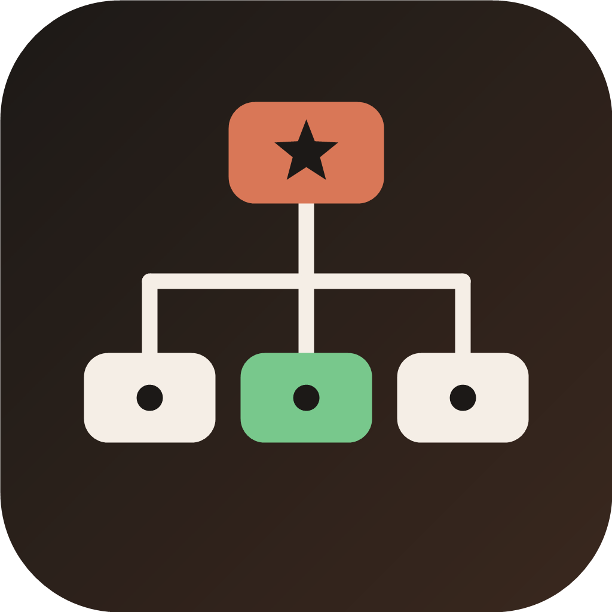

<div align="center">



# company-hq

**Run Claude Code like a company.** Every project gets a Board, executives, departments, managers,
workers, reviewers and a legal team. You hand over a request; they plan it, split it, check it and sign it
off, while you watch the whole org chart work live beside the chat.

[](LICENSE)
[](https://docs.claude.com/en/docs/claude-code)
[](CHANGELOG.md)
[](https://nodejs.org)
[](agents)

[Install](#install) · [What you see](#what-you-see) · [Usage and speed](#usage-and-speed) · [Quick start](#quick-start) · [How a run works](#how-a-run-works) · [Teams](#teams) · [Configuration](#configuration) · [FAQ](#faq)

</div>

---

One Claude session doing everything in sequence is slow, and nobody checks its work. **company-hq** turns
your request into a staffed plan: a CEO splits it across departments, each department's manager delegates
to specialist workers in parallel, a review panel (QA, code, security, legal, peer review) sends work back
until it is right, and the Board signs off with a report. It is built to be safe on an ordinary laptop:
outbound work is drafts only, and the number of Claude processes is capped by free memory.

<p align="center">
  
</p>

## What you see

The HQ pane sits beside the chat (or as a corner widget) and tells you, in plain words, what your company is doing:

| | |
|---|---|
| **Status at a glance** | A coloured status pill (Planning, Working, Board review, Done, Done with issues), live agent count, cost and elapsed time, with a spinner while work is under way. |
| **Where the run is** | A five-stage pipeline (Plan → Build → Review → Board → Report) that lights up as the run moves. |
| **Now** | One sentence on what is happening: *“Engineering is building ‘Public API’ with 2 agents; Legal is checking ‘Launch emails’.”* If Claude's usage limit stops the work, it says so, with the reset time. |
| **Tabs** | **Overview** · **Plan** · **Agents** · **Team** (department cards that light up with live workers) · **Tasks** (a card per task with status, round, reviewers and verdict) · **Activity** (every event, colour-coded). Keys `1`–`6` switch tabs. |
| **Plan** | The goal, what done means, your decisions, and every task laid out in steps: step 2 starts when step 1 is done. A one-line "plan at a glance" sits on the Overview. `/hq plan` opens it. |
| **Agents** | Everyone working right now (CEO, managers, reviewers, worker agents, and agents from your chat) with what each is doing, on which task, and for how long; where the work is by department; and who just finished. `/hq agents` opens it. |
| **Live** | Every Claude process the run has going, each with a ticking timer. A queued run says exactly what it is waiting for: which run holds the slots (in any project) or how much memory is free. Slot dots `●●○` and "updated 3s ago" show it is alive. |
| **Ask the company** | Type a request straight into the pane and press **Run**. |
| **Resume** | A run stopped by Claude's usage limit pauses instead of failing. **▶ Resume run** carries on later without redoing approved work. |
| **Task details** | Open any task card for its brief, deliverable and the reviewer's open issues. Work approved with issues still open is flagged `APPROVED ⚠`. |
| **Status row** | Above the prompt: `◆ HQ  WORKING  ▰▰▰▱▱ 2/5  Engineering is building “Public API”…  [Open] [Hide]` |

<p align="center">
  
</p>

## Features

- **A team per project.** `/hq init` reads your repo and tailors a startup, research or software team:
  departments, managers, workers and reviewers that fit what the project actually is.
- **Real parallel work.** Departments run side by side as separate Claude processes, and each manager
  fans out to worker subagents inside its process.
- **Review before done.** Every task goes to a review panel picked for the work, with up to two revision rounds.
  Anything outward-facing gets a legal review.
- **Board sign-off.** The Board (chair, risk, quality) approves, approves with conditions, or rejects, and writes
  `.company/runs/<id>/report.md`.
- **Live org chart.** A side pane, a corner widget and a status row above the prompt, in the terminal and the
  desktop app. Delegation from your ordinary chats shows up too.
- **Easy on your usage limit.** The default *lean* profile was tuned on real runs: one-pass reviews instead of
  reviewer swarms, at most 4 tasks per run, Sonnet throughout, and background processes without hooks, MCP
  servers or skills. See [Usage and speed](#usage-and-speed).
- **Survives the usage limit.** Runs pause instead of failing and resume where they stopped.
- **Obsidian notes.** Optionally, every run becomes a linked note in your vault.
- **Memory-aware.** At most 2 Claude processes at once across all projects (configurable), and a launch waits
  while free RAM is low.
- **Drafts only.** The company never sends email, posts, publishes, deploys, purchases or commits on its own.
- **Plays well with ECC.** [ECC](https://github.com/affaan-m/ECC) is a popular collection of Claude Code
  agents and skills. Specialist roles (code, security and language reviewers, planner, TDD) use its agents when
  it is installed, and fall back to the bundled agents when it is not. Nothing else is required.

## Requirements

- [Claude Code](https://docs.claude.com/en/docs/claude-code) with plugin mods (the terminal or the desktop app)
- [Node.js](https://nodejs.org) 20 or newer on your `PATH`
- The `claude` CLI signed in. Background runs use it: run `claude` once in a terminal and type `/login`.

## Install

In a Claude Code terminal session:

```
/plugin install company-hq --marketplace aadu2324/company-hq
```

Answer `y` to add the marketplace, then choose the **user** scope so it is available in every project.

<details>
<summary>From a shell, or in the desktop app</summary>

```bash
claude plugin install company-hq --marketplace aadu2324/company-hq
```

In the Claude desktop app: click **+** next to the prompt box → **Plugins** → **Add marketplace** →
`aadu2324/company-hq` → **Add plugin**.

</details>

**Already have sessions open?** Type `/reload-plugins` in each one. The plugin loads into the running session
and the conversation stays as it is.

## Quick start

Open a session in a project folder, then:

```
/hq init                       hire a team for this project (1–2 minutes)
/hq                            open the HQ pane
/hq run Add rate limiting to the API and draft a changelog post
```

Prefer to stay in the chat? Ask for `/company-hq:company <request>` and the session itself plays CEO,
dispatching the same departments and reviewers as subagents.

## Commands

| Command | What it does |
|---|---|
| `/hq` | Open the HQ pane |
| `/hq run <request>` | Hand a request to the company. It runs in the background and the pane follows it |
| `/hq init [startup\|research\|software]` | Hire a team tailored to this project. The type is detected if you leave it out |
| `/hq status` | Recent runs, with process slots and free memory |
| `/hq stop` | Stop the active run and all of its Claude processes |
| `/hq resume` | Carry on a paused, stopped or partly failed run. Approved work and the plan are kept |
| `/hq answer <text>` | Answer the question a run is waiting on; the CEO plans the rest around it |

From a terminal: `hq watch` checks your tracked fields now, `hq watch list` / `hq watch add "<field>" --arxiv "<query>" --hn "<query>"` manage them, and `hq watch --schedule` runs it every morning.

## How a run works


1. **CEO** (read-only) turns the request into a few tasks (at most 4 in the lean profile, 8 in thorough), one
   department each, with real dependencies and reviewers per task. Anything ambiguous becomes a question.
2. **Departments** run in dependency order, two at a time by default. Each task is one manager process that does
   small work itself and delegates the rest to its workers as subagents.
3. **Review** for each task approves it or sends it back with specific fixes (one round in lean, two in thorough).
4. **Board** signs off on the whole run and writes the report.

If Claude's usage limit is hit at any point, the run **pauses**: approved tasks stay approved, interrupted ones keep
their conversation, and `/hq resume` carries on without re-planning.

## Usage and speed

HQ runs on your Claude plan, so it was tuned against real runs. Measured on two runs of a 7- and a 5-task request
before tuning, the review panels (4–5 reviewer subagents per task, each finished reviewer waking the panel to
re-read everything) were **64% of the spend**, managers 27% and planning 10%. Every background process also
carried **~77k tokens** of hooks, MCP servers and skills it never used.

| | **lean** (default) | **thorough** |
|---|---|---|
| Review | one reviewer pass covering up to 2 perspectives, 1 revision round | a panel of reviewer subagents, 2 rounds |
| Tasks per run | at most 4 | at most 8 |
| Models | Sonnet everywhere, medium effort | Opus for CEO, Board and org designer |
| Background processes | no hooks, MCP servers or skills (agents and CLAUDE.md kept) | your full Claude Code setup |
| Measured per call | ~64k tokens of context, about 2× faster | ~153k tokens |

Switch with `"profile": "thorough"` in `~/.claude/company/config.json`. Any `models` you set there still win.

Everything lives in plain files inside the project:

| Path | Contents |
|---|---|
| `.company/org.json` | The team. Commit it if you like |
| `.company/runs/<id>/state.json` | One run: plan, tasks, verdicts, Board decision, cost |
| `.company/runs/<id>/report.md` | The Board's report |
| `.company/runs/`, `.company/events.jsonl` | Run logs and activity, git-ignored automatically |

## Teams

| Template | Executives | Departments |
|---|---|---|
| **startup** | CEO, CTO, CMO, General Counsel | Product, Engineering, Marketing, Web & Landing Pages, Sales & Outreach, Media & Social, Finance, Legal & Compliance |
| **research** | Program Director, Chief Scientist, Ethics & Compliance Officer | Literature & Novelty, Methodology, Experiments, Analysis, Writing, Outreach, Ethics & Compliance |
| **software** | CEO, CTO, General Counsel | Product, Engineering, Documentation, Legal & Compliance |
| **frontier** | Research Director, Chief Scientist, Ethics & Integrity Officer | Frontier & Gap Discovery, Theory & Proofs, Experiments, Writing & Submission, Outreach, Ethics & Integrity |

## Research mode

Hire a **frontier** team (`/hq init frontier`) for work at the edge of a field: AI research, mathematics, physics.

1. **Name a field, not a problem.** The gap analyst maps the frontier from verified sources, lists gaps that are
   still open (each checked against recent work), and ranks them by impact, tractability on your machine and
   how verifiable a result would be.
2. **You choose.** The run pauses with a question (**NEEDS YOU** in the pane). Answer in the pane or with
   `/hq answer`, and the CEO plans the rest around your choice.
3. **The work.** Theory tasks state the problem formally, check small cases and counterexamples, attempt the
   proof with every gap marked, and formalise in Lean 4 where it is installed. Experiments reproduce the strongest
   baseline first.
4. **Verification decides.** An adversarial proof verifier and a top-venue peer reviewer gate every result, with
   stricter review than the lean profile allows elsewhere. Nothing is called proved, solved, novel or state of the
   art unless the run checked it; otherwise the deliverable is an honest technical report.

Startup teams get the same loop for markets: with no idea given, they find underserved problems with evidence of
demand, ask you which to pursue, then validate before building.

> [!IMPORTANT]
> HQ makes research faster and more systematic. It cannot promise breakthroughs, and AI-assisted proofs need
> formal or expert verification before you rely on them. Check each venue's and prize's rules on AI assistance and
> authorship: you are the author and responsible for what you submit.

## Your second brain

With Obsidian set up, what the company learns accumulates in your vault, not just in run notes:

| Folder | What goes there |
|---|---|
| `Literature/<field>/` | One note per paper the company cites or the watcher finds: authors, year, link, abstract |
| `Gaps/<field>/` | Every research gap and market opportunity found, with evidence and scores |
| `Fields/<field>.md` | A hub per field linking its papers, gaps and projects |
| `Research Watch/` | A digest per day of what is new, with papers that may affect one of your open gaps flagged |

Notes are written once and then left to you, so your annotations survive. Set `"knowledgeFolder"` (inside
`obsidian`) to put these under a folder such as `Second Brain`.

**Research watch.** Fields are tracked automatically when a run finds gaps, or with `hq watch add`. Once a day
the watcher asks arXiv for new papers and Hacker News for new stories in each field. It only sends the search
terms, calls no Claude model and costs no usage. `hq watch --schedule` sets this up with Task Scheduler on Windows;
on macOS and Linux it prints the crontab line to add.

The org designer starts from the closest template and adapts it to the repository, then the result is
validated before it is saved. If tailoring fails, the template is used as is.

<details>
<summary>The 22 bundled role agents</summary>

| Leadership | Workers | Reviewers |
|---|---|---|
| `co-board` · `co-ceo` · `co-cto` · `co-org-designer` | `co-product-manager` · `co-market-analyst` · `co-finance-analyst` · `co-copywriter` · `co-landing-page-dev` · `co-outreach-writer` · `co-media-manager` · `co-gap-analyst` · `co-literature-scout` · `co-theorist` · `co-methodologist` · `co-experimentalist` · `co-data-analyst` · `co-paper-writer` | `co-qa-reviewer` · `co-peer-reviewer` · `co-proof-verifier` · `co-legal-counsel` |

They install as `company-hq:co-<name>` and can be used directly in any chat too.
</details>

## Configuration

Optional. Create `~/.claude/company/config.json` with any of these keys:

| Key | Default | Meaning |
|---|---|---|
| `maxProcesses` | `2` | Claude processes allowed at once, across all projects |
| `minFreeMemMB` | `700` | A launch waits while free RAM is below this |
| `starvationGraceSec` | `30` | If nothing is running, launch anyway after this long |
| `profile` | `lean` | `lean` or `thorough`, see [Usage and speed](#usage-and-speed) |
| `models` | from the profile | Model per role: `ceo`, `board`, `orgDesigner`, `manager`, `reviewer` |
| `effort` | from the profile | Effort per role (`low`, `medium`, `high`) |
| `isolate` | from the profile | `false` keeps your hooks, MCP servers and skills in background processes |
| `obsidian` | off | `{ "vault": "<vault folder>", "folder": "HQ", "knowledgeFolder": "" }`: run notes in `folder`, literature, gaps and fields in `knowledgeFolder` |
| `watch` | none | `{ "launcher": ["<program>", "<args>"] }` wraps the scheduled watch command (for example, to hide its window on Windows) |
| `permissionMode` | `acceptEdits` | Permission mode for background processes |
| `processTimeoutMin` | `90` | A process running longer than this is stopped |
| `vramGB` | none | GPU memory, so workers size experiments to fit. RAM is detected |
| `claudePath` | auto | Path to the `claude` binary if it is not found |

To change a role, add it to `~/.claude/company/catalog.json` (same shape as
[`engine/catalog.json`](engine/catalog.json)); your roles override the bundled ones. To change a team
template, copy it into `~/.claude/company/templates/`.

## Safety and cost

- **Drafts only.** Every prompt carries the company policy: no sending, posting, publishing, deploying,
  purchasing or signing up, and no commits or pushes unless your request asks for them.
- **Background permissions.** Managers run with `acceptEdits`, so shell commands outside your Claude Code
  allow-list are refused in background runs.
- **Your hooks in background runs.** To save usage, the lean profile starts background processes with your hooks,
  MCP servers and skills turned off. If you rely on hooks as safety guards (secret scanners, commit blockers) or a
  role needs an MCP tool, set `"isolate": false` to keep lean's other savings with your full setup, or use
  `"profile": "thorough"`.
- **A team that came with a repository.** `.company/org.json` becomes part of the prompts, so read one you did
  not write before your first run in that project. Custom roles in it always run as `general-purpose`, with their
  text length-limited.
- **Cost.** Watching is free: the pane reads local files and makes no model calls. Runs use your Claude plan
  like any other session; each run's cost is shown in the pane.

## Obsidian

Add your vault to `~/.claude/company/config.json`:

```json
{ "obsidian": { "vault": "/path/to/Your Vault", "folder": "HQ" } }
```

Every run then writes `HQ/<project>/<date> <request>.md` (status, plan, tasks, review verdicts, Board decision,
links to the report and deliverables) and keeps `HQ/<project>/<project> HQ.md` and `HQ/HQ.md` up to date. Notes
link to `[[<project>]]`, so runs sit next to your own project note in the graph. `hq obsidian` exports past runs.
HQ never creates the vault and never writes outside it.

## FAQ

<details>
<summary><b>Do I need to restart my sessions after installing?</b></summary>

No. Run `/reload-plugins` in a session that is already open. New sessions load the plugin automatically.
</details>

<details>
<summary><b>A run fails at once with "Claude CLI is not logged in".</b></summary>

Background runs use the `claude` CLI, which has its own sign-in. Run `claude` in a terminal and type `/login`.
</details>

<details>
<summary><b>The row above the prompt doesn't appear.</b></summary>

It shows only in a project that has a team (`.company/org.json`). Run `/hq init`, or `/hq` and press
**Hire a team**. If you clicked **Hide**, it stays hidden for that session.
</details>

<details>
<summary><b>Will it use my ECC agents?</b></summary>

Yes, when ECC is installed: code review, security review, planning, TDD and the other specialist roles prefer
`ecc:*` agents and fall back to the bundled ones otherwise. See [`engine/catalog.json`](engine/catalog.json).
</details>

<details>
<summary><b>Is there a terminal dashboard?</b></summary>

Yes, from a clone: `cd engine && npm install && node bin/hq.js`. It shows every project's org chart, runs and
activity, and takes requests from a prompt bar.
</details>

## Development

```bash
git clone https://github.com/aadu2324/company-hq
cd company-hq
claude plugin validate .
claude plugin test .              # the mod (pane, band, /hq, logging)
cd engine && npm test             # the engine (plan, DAG, slots, agents, full run with a fake CLI)
```

Run your working copy with `claude --plugin-dir .`. Layout:

```
.claude-plugin/   manifest, marketplace entry, icon
hooks/            the mod: register.tsx (hooks), model.ts (state → words), view.tsx (pane, band, widget)
assets/           README animation (regenerate with: node scripts/make-demo-svg.mjs)
agents/           19 role agents (company-hq:co-*)
skills/company/   interactive company mode
engine/           orchestrator, catalog.json, templates/, tests
```

See [CONTRIBUTING.md](CONTRIBUTING.md).

## License

[MIT](LICENSE)
