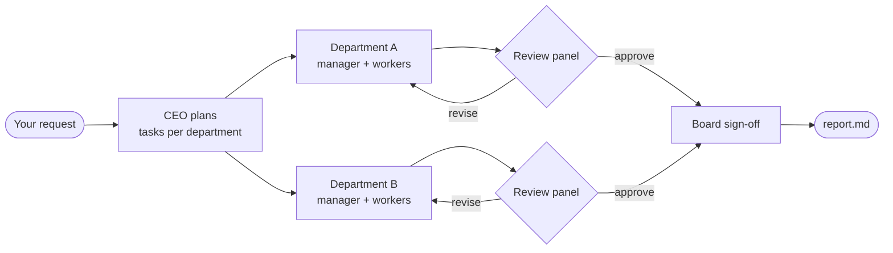

<div align="center">


# company-hq

**See your Claude Code agents work like a company: Board, executives, departments, workers and reviewers, live beside the chat.**

[](LICENSE)
[](https://docs.claude.com/en/docs/claude-code)
[](CHANGELOG.md)
[](#privacy-and-cost)

[Install](#install) · [Quick start](#quick-start) · [Commands](#commands) · [How it works](#how-it-works) · [FAQ](#faq)

</div>

---

When Claude Code delegates to subagents, the work disappears into a single transcript. **company-hq** gives
it an org chart. Every project gets a team: a Board, a CEO and CTO, and departments with managers, workers
and reviewers. This mod shows that team in a side pane, updating every two seconds as agents pick up and
finish work.

```
 Claude HQ ─────────────────────────────────────────────────────────────
 Acme · startup · 1 active run · 3 agent(s) working       [Stop run] [Refresh]

 Org chart
 Board of Directors · chair, risk, quality
 ★ CEO
   ● Product — Head of Product
       Product Manager
       review: QA Reviewer
   ● Sales & Outreach — Head of Outreach
       ● Outreach Writer ×1
       review: Legal Reviewer
   ★ CTO
     ● Engineering — Engineering Manager
         ● Software Engineer ×2
         review: Code Reviewer, Security Reviewer

 Goal: Ship the public API and draft launch outreach
 ● T1 engineering: Build API (2 working)
 ⚖ T2 outreach: Cold email sequence r1
 ○ T3 product: Launch PRD

 Activity
 10:16 CEO planned 3 task(s): Ship the public API and draft launch outreach
 10:16 ⚙ manager T1 engineering
 10:17 → general-purpose: implement endpoints
 10:21 ⚖ T2 revise (6/10): tighten the CAN-SPAM footer
```

## Features

- **Live org chart.** Departments that are working light up, and each worker role shows how many agents
  are running it right now.
- **Runs at a glance.** Each task's status, revision round and reviewer verdicts, the Board's sign-off,
  and the cost of the run.
- **Status row above the prompt.** `HQ · Acme · ▶ executing 2/5 tasks · 3 agent(s) working [Open] [Hide]`
- **Delegation from the chat too.** Subagents you start from an ordinary conversation appear in the activity
  feed, marked `chat`.
- **Corner widget.** Minimise the pane and it becomes a small widget showing the current run.
- **Works in the terminal and in the desktop app**, drawn with the native elements of each.
- **Costs nothing to watch.** It only reads local files. It makes no model calls and no network requests.

## Install

In a Claude Code terminal session:

```
/plugin install company-hq --marketplace aadu2324/company-hq
```

Answer `y` to add the marketplace, then choose the **user** scope so it loads in every project.

<details>
<summary>From a shell, or in the desktop app</summary>

From a shell:

```bash
claude plugin install company-hq --marketplace aadu2324/company-hq
```

In the Claude desktop app: click **+** next to the prompt box → **Plugins** → **Add marketplace** →
`aadu2324/company-hq` → **Add plugin**.

</details>

**Already have sessions open?** Type `/reload-plugins` in each one. The mod loads into the running
session and keeps its whole conversation; you don't need to restart anything.

## Quick start

Open a session in a project folder, then:

```
/hq init            # hire a team for this project (about 1–2 minutes)
/hq                 # open the HQ pane
/hq run Add rate limiting to the API and draft a changelog post
```

## Commands

| Command | What it does |
|---|---|
| `/hq` | Open the HQ pane |
| `/hq run <request>` | Hand a request to the company; it runs in the background and the pane follows it |
| `/hq init [startup\|research\|software]` | Hire a team tailored to this project. The type is detected if you leave it out |
| `/hq status` | Recent runs, with free memory and process slots |
| `/hq stop` | Stop the active run and its processes |

## How it works



The team and its runs live in plain files inside the project:

| Path | Contents |
|---|---|
| `.company/org.json` | The project's team: executives, departments, managers, workers, reviewers |
| `.company/runs/<id>/state.json` | One run: plan, tasks, verdicts, Board decision, cost |
| `.company/runs/<id>/events.jsonl` | That run's activity |
| `.company/events.jsonl` | Delegation from ordinary chat sessions |
| `~/.claude/company/catalog.json` | Role ids mapped to titles and agents |

The mod reads these files and draws them. Running the team (planning, delegating, reviewing) is done by the
**Claude HQ engine**, which `/hq run`, `init`, `stop` and `status` call at `~/.claude/company/hq/bin/hq.js`.

> [!NOTE]
> The engine is not bundled in this repository yet. Without it, the pane still shows any `.company/` files
> in the project, and the `/hq` commands report that the engine could not be found.

## Privacy and cost

- Reads only the files listed above. Nothing is sent anywhere.
- Makes no model calls, so watching costs no tokens.
- Polls every 2 seconds. A folder without a team is checked every 30 seconds.

## FAQ

<details>
<summary><b>Do I need to restart my sessions after installing?</b></summary>

No. Run `/reload-plugins` in a session that is already open: it loads the mod and runs its start-up, and the
conversation stays as it was. New sessions load it automatically.
</details>

<details>
<summary><b>The row above the prompt doesn't appear.</b></summary>

It shows only in a project that has a team (`.company/org.json`). Run `/hq init`, or `/hq` to open the pane
and use **Hire a team**. If you clicked **Hide**, it stays hidden for that session.
</details>

<details>
<summary><b>Does it slow Claude Code down?</b></summary>

It reads a few small JSON files every two seconds, and only the last 24 KB of each activity log.
</details>

## Development

```bash
git clone https://github.com/aadu2324/company-hq
cd company-hq
claude plugin validate .
claude plugin test .
```

To run your working copy instead of the installed version, start Claude Code with `--plugin-dir .`.
The files are small: `hooks/register.tsx` (the mod), `types/index.d.ts` (its state contract) and
`hq.test.tsx` (tests). See [CONTRIBUTING.md](CONTRIBUTING.md).

## License

[MIT](LICENSE)
